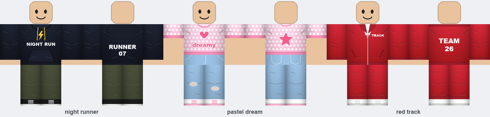
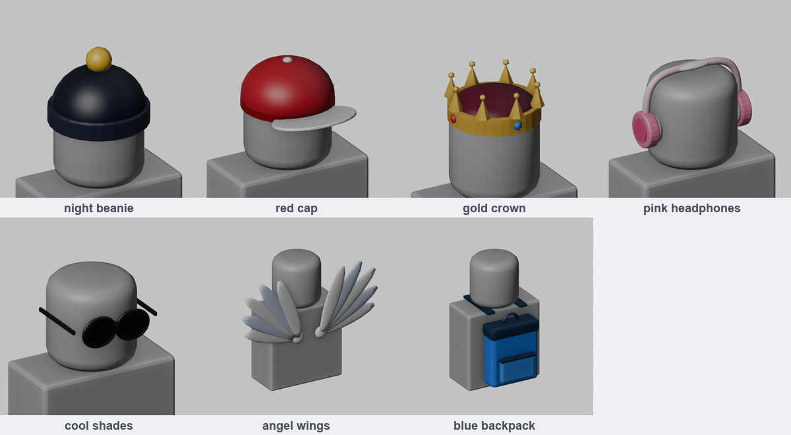

# roblox-ugc-toolkit

Make Roblox avatar items by describing them in small JSON files: classic shirts, pants and t-shirts, plus 3D hats, glasses, wings and backpacks. A converter also turns any GLB/FBX/OBJ model into a Roblox-ready accessory.





## What it does

- **Classic clothing:** writes upload-ready 585×559 Shirt and Pants images, aligned pixel-for-pixel with Roblox's official R15 template, plus 512×512 T-Shirts. Every build also writes a front, back and side preview, so you can check an item before paying to upload it.
- **3D accessories:** a beanie, cap, crown, headphones, sunglasses, wings and a backpack, built in Blender and exported as FBX. The build checks each against Roblox's rigid-accessory rules: one mesh, at most 4,000 triangles, watertight, and inside the size limit for its type.
- **Model converter:** merges a downloaded or AI-generated model into one mesh, cuts its triangles below the limit, bakes its colors into one small texture, scales it to fit, and exports FBX. Tested on a 60-piece, 15,924-triangle model: it came out as 1 mesh with 3,776 triangles.

| Folder | What's in it |
|---|---|
| `designs/` | Outfits: classic shirt, pants and t-shirt (one JSON file per outfit) |
| `accessories/` | 3D accessories (one JSON file each) |
| `models/` | Your own 3D models to convert. Kept out of git. |
| `output/` | Generated files that are ready to upload. Kept out of git. |
| `templates/` | Roblox's official templates, for drawing by hand or checking alignment |
| `tools/` | The generators |

## Setup

You need:
- **Python 3** with Pillow 10.1 or newer: `pip install -r requirements.txt`
- **[Blender](https://www.blender.org/download/)**, for accessories and the converter. Tested with Blender 5.2.3.
- **Roblox Studio**, to fit and upload accessories.

The commands below use the macOS Blender path. On Windows or Linux, replace it with your `blender` executable.

Roblox's official templates are optional; the clothing tool doesn't need them. To download them for drawing by hand or checking alignment:

```bash
curl -L -o templates/t.zip https://prod.docsiteassets.roblox.com/assets/accessories/classic-clothing/Classic-Clothing-Templates.zip
unzip -o templates/t.zip -d templates && rm templates/t.zip
```

## Build

```bash
# clothing -> output/<name>/shirt.png, pants.png, tshirt.png, preview.png
python3 tools/rbx_clothing.py                     # every file in designs/
python3 tools/rbx_clothing.py designs/red_track.json

# accessories -> output/accessories/<name>/<name>.fbx, texture.png, preview_*.png
/Applications/Blender.app/Contents/MacOS/Blender -b --factory-startup -P tools/rbx_accessory.py
/Applications/Blender.app/Contents/MacOS/Blender -b --factory-startup -P tools/rbx_accessory.py -- accessories/gold_crown.json

# convert your own model (GLB, GLTF, FBX or OBJ)
/Applications/Blender.app/Contents/MacOS/Blender -b --factory-startup -P tools/rbx_convert.py -- models/my_hat.glb --name my_hat --type Hat
```

Converter options:
- `--type Hat|Face|Back` chooses the size limit to fit.
- `--width 1.6` sets the final width in studs.
- `--rotate 180` turns the model if it faces backwards.
- `--budget 3800` sets the triangle target.

Image-textured models are reduced to flat colors; flat-color models, such as most AI and Three.js exports, keep their look.

Always open the preview before you upload. Every upload costs Robux.

## Clothing options (`designs/*.json`)

Colors are hex values, for example `"#ff5d8f"`. Leave out any option you don't need.

**shirt**: `type` is one of `tee`, `longsleeve`, `hoodie`, `jacket` or `tank`.
- `color`, `color2` (gradient bottom), `trim` (cuffs and hem), `sleeve_color`
- `length` (128 = full length, ~90 = crop top), `sleeves` (`long`, `short`, `none`), `neck` (`crew`, `v`)
- `front_text`, `front_icon`, `back_text`, `back_icon`. Icons: `star`, `heart`, `bolt`, `diamond`, `smile`. Use `\n` to start a new line of text.
- `text_color`, `text_outline`, `icon_color`, `icon_outline`, `font` (path to a .ttf file)
- `pattern`: `{"type": "dots" | "checker" | "hstripes" | "vstripes" | "plaid" | "camo", "color": "#fff", "size": 12}`
- `stripes`: `{"color": "#fff", "count": 2}` puts stripes down the outer sleeves and the sides of the body
- hoodie extras: `string_color`. Jacket extras: `inner_color`
- `shading: false` turns off the folds and shadows

**pants**: `type` is one of `jeans`, `cargo`, `joggers`, `shorts` or `trackpants`.
- `color`, `color2`, `trim`, `stitch`, `belt`, `pattern`, `stripes`
- `ripped: true`, `leg_length` (128 = full length, ~58 = shorts), `cuffs: true`
- shoes: `shoes`, `sole`, `laces`, `shoe_accent`, `socks`, `shoe_height` (max 76)

**tshirt** (optional square decal): `text`, `icon`, `bg`, plus the same color options as above.

Transparent areas show the avatar's skin. That is how short sleeves, crop tops, shorts and ripped holes work.

## Accessory options (`accessories/*.json`)

`type` is one of `beanie`, `cap`, `crown`, `headphones`, `sunglasses`, `wings` or `backpack`. Override any part color in `colors`:

| type | color keys |
|---|---|
| beanie | main, cuff, pom (`"pompom": false` removes the pom-pom) |
| cap | main, brim, button, band |
| crown | gold, velvet, gem, gem2 (`"spikes": 8`) |
| headphones | main, cup, cushion, accent |
| sunglasses | lens, frame |
| wings | main, accent (`"feathers": 7`) |
| backpack | main, accent, pocket, strap |

Each build line ends in `[OK]`, or explains what to fix.

## Uploading

**Clothing (Shirt, Pants, T-Shirt)**
1. Go to the [Creator Dashboard](https://create.roblox.com/dashboard/creations), open **Avatar Items**, then the **Classics** tab, and upload the PNG.
2. Set the Asset Type to Shirt, Pants or T-Shirt, then add a name and description. Uploading costs 80 Robux.
3. To sell it, open the item's **Configure** page, turn on **On Sale** and set a price.

**Accessories (in Roblox Studio)**
1. On the **Home** tab (or the **File** menu), click **Import 3D** and choose the `.fbx` file. Use the Rthro rig scale for Normal bodies.
2. If the item imports facing backwards, rotate it 180°. The models face −Y in Blender.
3. On the **Avatar** tab, click **Accessory** to open the Accessory Fitting Tool. Select the mesh and pick its type (Hat, Face or Back).
   - Adjust the fit. The default placement often sits too low, so scale the item down and move it up until the face shows.
   - Then generate the accessory.
4. Select the new accessory and click **UGC Validation** on the Avatar tab. It checks the item against Roblox's rules before you pay anything.
5. In Explorer, right-click the accessory and choose **Save to Roblox**. Submit it as an **Avatar Asset**, pick the asset type, then click **Submit**. This pays the 80 Robux upload fee.
6. After moderation, open the item in the Creator Hub, go to **Manage Item**, set the price, and click **Publish Item**.

## What selling costs

Roblox's rules as of Nov 2026. Check the [Marketplace Policy](https://create.roblox.com/docs/marketplace/marketplace-policy) and [fees page](https://create.roblox.com/docs/marketplace/marketplace-fees-and-commissions) for changes.

- **To upload:** ID verification and 80 Robux per upload. The fee isn't refunded if moderation rejects the item.
- **To publish and sell:**
  - 2-step verification.
  - **Roblox Plus, or Premium 1000/2200.** It must stay active, or the item goes off sale.
  - A publishing advance: **1,500 Robux for a hat** (non-limited). Roblox pays it back gradually out of its share of your sales.
- **What you earn:** 30% of each Marketplace sale, more if you price above the minimum. Inside your own game, you also get the game owner's 40%.
- **Content rules:** don't copy brand logos, other games' characters or real people. Roblox removes those items, and you lose the fees.

## License

MIT. See [LICENSE](LICENSE).

Not affiliated with or endorsed by Roblox Corporation. Roblox is a trademark of Roblox Corporation.
